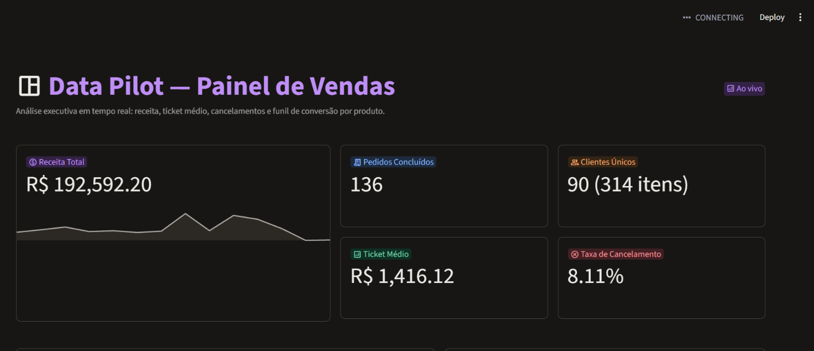
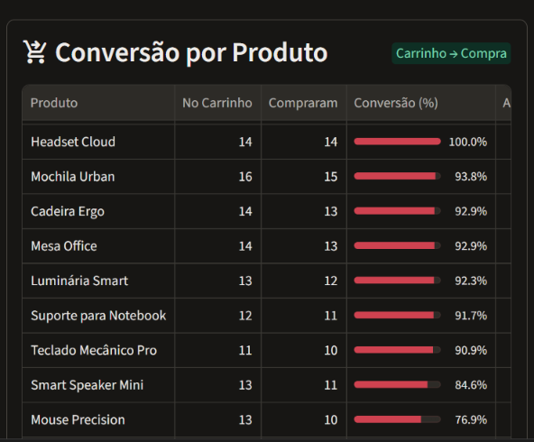
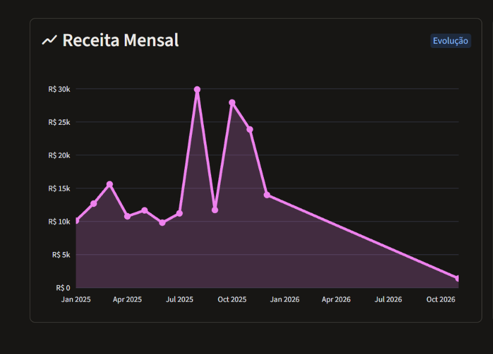
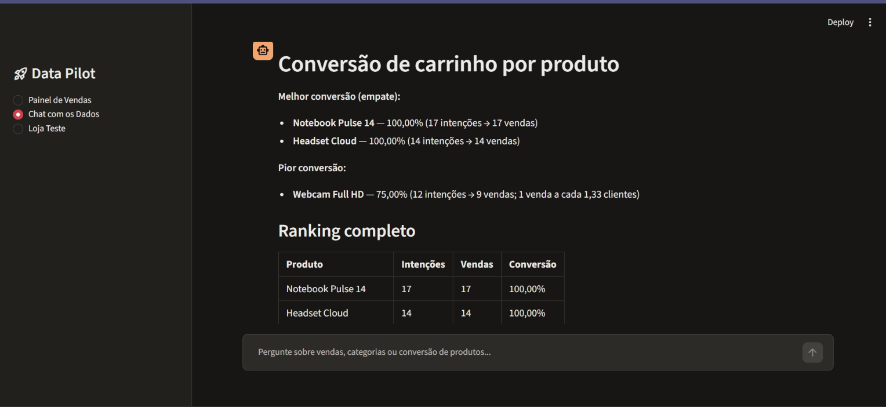
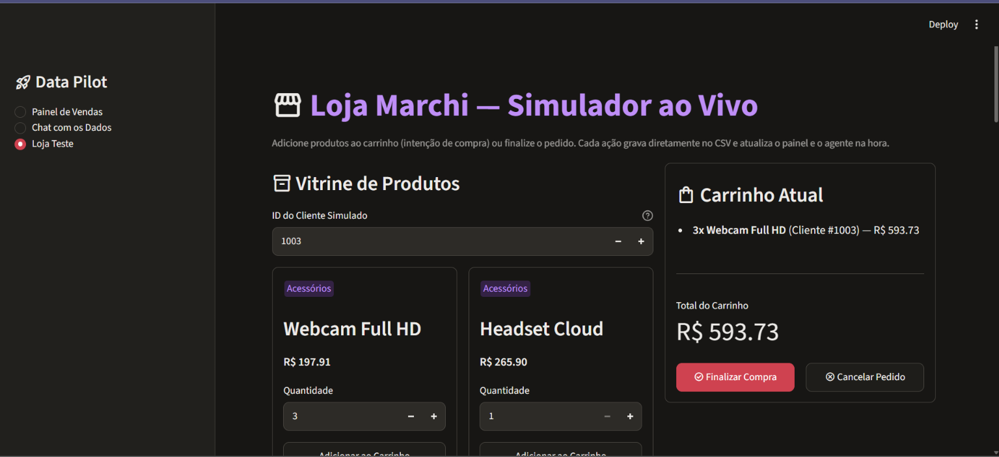

🚀 Data Pilot — Análise Inteligente de Vendas com Agentes de IA

O Data Pilot é uma aplicação full-stack de análise de dados e inteligência de negócios construída em Python, Streamlit e Plotly, integrada a um Agente de IA via OpenRouter (Tool Calling) e a um simulador de Loja Fachada que atualiza a base de dados em tempo real.

💡 Projeto desenvolvido como parte da trilha de estudos na DIO (Digital Innovation One) com o auxílio e mentoria do Gemini Pro na arquitetura, implementação das métricas de negócio e construção das funcionalidades interativas.

O sistema foi desenhado sob o princípio "Python calcula, IA explica": todas as métricas financeiras e operacionais são processadas de forma determinística via pandas, eliminando alucinações matemáticas do LLM e garantindo precisão absoluta tanto nos gráficos quanto nas respostas do chat.

✨ Funcionalidades Principais

📊 Painel Executivo Interativo (Painel de Vendas)

Filtros dinâmicos por categoria de produto.

Cards de KPIs em tempo real: Receita Total, Pedidos Concluídos, Ticket Médio, Clientes Únicos / Itens Vendidos e Taxa de Cancelamento.

Gráfico de evolução da Receita Mensal com Plotly.

Funil de Conversão por Produto (Carrinho → Compra): Mede quantos clientes adicionaram cada produto ao carrinho, quantos concluíram a compra, o percentual de conversão e a razão ("a cada X clientes interessados, 1 compra é concluída").

🤖 Agente Analista de Dados (Chat com os Dados)

Conversa em linguagem natural conectada ao OpenRouter com suporte a Tool Calling (chamada de funções) e sistema automático de fallback entre modelos gratuitos.

Aciona diretamente as funções de src/metrics.py para responder perguntas sobre faturamento, categorias, histórico mensal e gargalos de conversão por produto.

🛒 Simulador de E-commerce ao Vivo (Loja Fachada)

Vitrine interativa gerada a partir do catálogo real do dataset.

Permite simular adição ao carrinho (status="carrinho"), finalização de pedido (status="concluido") e cancelamento (status="cancelado"), gravando os eventos diretamente no CSV processado e recalculando os KPIs instantaneamente.

🎯 Desafios Avançados Implementados

Além do escopo base da trilha, o projeto contempla quatro evoluções completas de portfólio:

Nova Métrica de Negócio: Criação da métrica de Taxa de Conversão de Carrinho por Produto (product_conversion_rate) e contagem de Clientes Únicos (unique_clients) em src/metrics.py.

Nova Visualização Analítica: Tabela interativa de Conversão por Produto com barras de progresso integradas e indicador de esforço por venda (clientes por compra concluída).

Nova Intenção com Parâmetro no Agente: Ferramenta get_product_conversion(produto=...) no src/agent.py, permitindo consultar o funil geral ou filtrar por um produto específico via linguagem natural.

Portfólio Documentado com Capturas de Tela: Documentação técnica estruturada com demonstração visual das três telas da aplicação.

📸 Demonstração da Interface
### 1. Painel de Vendas e Conversão por Produto

### 2. Conversa com os Dados (Agente de IA)

### 3. Loja Fachada (Simulador de Pedidos ao Vivo)

🏗️ Arquitetura do Projeto

data-pilot-vendas/
├── assets/                     # Capturas de tela para documentação
├── data/
│   ├── raw/
│   │   └── sales.csv           # Base bruta de vendas
│   └── processed/
│       └── sales_clean.csv     # Base higienizada e atualizada pela Loja Fachada
├── src/
│   ├── __init__.py
│   ├── etl.py                  # Pipeline de limpeza (ETL) e gravação de eventos ao vivo
│   ├── metrics.py              # Regras de negócio puras (receita, ticket, cancelamento, conversão)
│   └── agent.py                # Integração com OpenRouter, Tool Calling e fallback de modelos
├── app.py                      # Interface principal em Streamlit (Painel, Chat e Loja)
├── main.py                     # Ponto de entrada da aplicação
├── .env.example                # Modelo de variáveis de ambiente
├── requirements.txt            # Dependências do projeto
└── README.md

🛠️ Tecnologias Utilizadas

Linguagem: Python 3.13+

Manipulação de Dados: Pandas

Interface Web & Visualização: Streamlit, Plotly Express

IA & Orquestração de Ferramentas: OpenAI SDK conectado à API do OpenRouter

Configuração de Ambiente: Python-dotenv

🚀 Como Executar Localmente

1. Clonar o repositório

git clone https://github.com/Cmarchi2003/data-pilot-vendas.git
cd data-pilot-vendas

2. Criar e ativar o ambiente virtual

# Windows (PowerShell)
python -m venv .venv
.\.venv\Scripts\Activate.ps1

# Linux / macOS
python3 -m venv .venv
source .venv/bin/activate

3. Instalar as dependências

pip install -r requirements.txt

4. Configurar as variáveis de ambiente

Crie um arquivo .env na raiz do projeto baseado no .env.example e insira sua chave gratuita do OpenRouter:

OPENROUTER_API_KEY=sk-or-v1-sua-chave-aqui
OPENROUTER_MODEL=openrouter/free

5. Processar a base inicial (ETL) e iniciar o servidor

python src/etl.py
streamlit run app.py

Acesse no navegador o endereço indicado no terminal (geralmente http://localhost:8501).

💡 Exemplos de Perguntas para o Agente

"Qual é o resumo geral das vendas?"

"Qual produto tem a melhor e a pior taxa de conversão de carrinho?"

"Como foi a evolução da receita mensal?"

"Qual é o ticket médio e a taxa de cancelamento da categoria Eletrônicos?"

🙌 Créditos e Aprendizado

Este projeto foi desenvolvido por Carlos Eduardo Silva de Marchi com base no curso Data Pilot — Análise Inteligente de Dados com Agentes de IA da DIO (Digital Innovation One) e contou com o apoio do Gemini Pro para a expansão das métricas de negócio (funil de conversão por produto), resiliência do agente e construção do simulador de loja ao vivo.

📝 Licença

Este projeto foi desenvolvido para fins de estudo e portfólio em Engenharia e Análise de Dados com Inteligência Artificial.